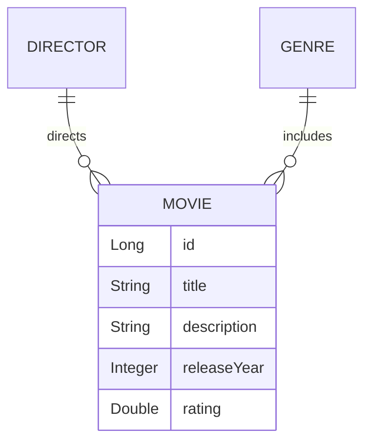

<p align="center">
  
</p>

# Movie Management API

A REST API for managing movies together with their directors and genres.
Built with Spring Boot and PostgreSQL, using a layered architecture and DTOs.

## Features

- CRUD endpoints for movies with correct HTTP status codes (`201 Created`, `204 No Content`, `404 Not Found`)
- Pagination and sorting: `GET /movies?page=0&size=10&sort=id,asc`
- JPA relationships: each movie belongs to a director and a genre (lazy loading)
- Request / response DTOs with a mapper, entities are not exposed
- Validation rules on the request DTO (`@NotBlank`, `@NotNull`, `@Min`, `@Max`)
- Global exception handling with `@RestControllerAdvice` and a custom `NotFoundException`
- Swagger UI and a Postman collection
- PostgreSQL in Docker Compose

## Tech stack

Java 21 · Spring Boot 4 · Spring Data JPA / Hibernate · Spring Security · PostgreSQL 16 · Bean Validation · springdoc-openapi · Lombok · Gradle · Docker Compose

## Data model



## API

| Method | Endpoint | Description | Response |
|---|---|---|---|
| `GET` | `/movies` | List movies (paged and sorted) | `200 OK` |
| `GET` | `/movies/{id}` | Get one movie | `200 OK` / `404` |
| `POST` | `/movies` | Create a movie | `201 Created` |
| `PUT` | `/movies/{id}` | Update a movie | `200 OK` / `404` |
| `DELETE` | `/movies/{id}` | Delete a movie | `204 No Content` |

**Request body example**

```json
{
  "title": "Inception",
  "description": "Science fiction movie",
  "releaseYear": 2010,
  "rating": 8.8,
  "directorId": 1,
  "genreId": 1
}
```

Directors and genres are currently added directly in the database.

## Getting started

**Requirements:** JDK 21, Docker

```bash
git clone https://github.com/MehribanNusretova/movie-management.git
cd movie-management
docker compose up -d      # PostgreSQL 16 on port 5432, database movie_db
./gradlew bootRun
```

- API: `http://localhost:8080/movies`
- Swagger UI: `http://localhost:8080/swagger-ui/index.html`
- Postman collection: [`src/postman/MovieManagementAPI.postman_collection.json`](src/postman/MovieManagementAPI.postman_collection.json)

## Project structure

```text
src/main/java/com/example/moviemanagement
├── config        # application, security and Swagger configuration
├── controller    # MovieController
├── dto           # request / response DTOs, error response
├── entity        # Movie, Director, Genre, User
├── enums         # roles
├── exception     # NotFoundException, global handler
├── mapper        # MovieMapper
├── repository    # Spring Data JPA repositories
├── service       # service interfaces and implementations
└── validation    # validation messages
```

## Roadmap

- JWT authentication (in progress: `User` entity with `UserDetails` and BCrypt)
- Endpoints for directors and genres
- Filtering movies by genre, director and year
- Unit tests for the service layer

## Author

**Mehriban Nüsrətova** — Junior Java Backend Developer

[LinkedIn](https://www.linkedin.com/in/mehriban-nusratova) · [GitHub](https://github.com/MehribanNusretova)
